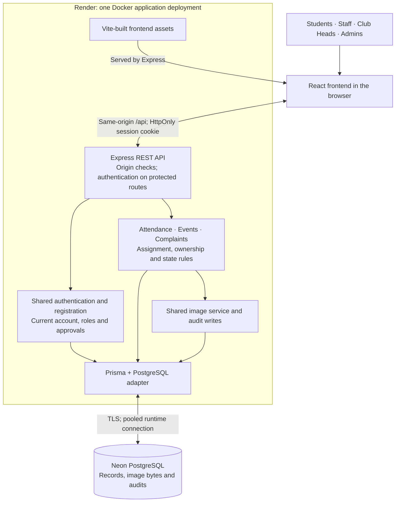
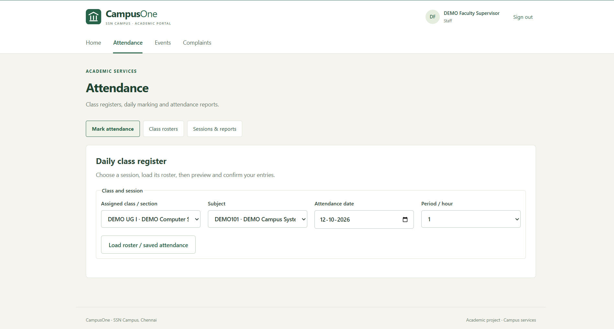

# CampusOne

**A role-aware campus portal, built as an end-to-end software engineering case study.**

CampusOne brings attendance, club events and campus complaints into one application for Students, teaching Staff, Club Heads and Administrators. I built it to demonstrate practical understanding of the Software Development Life Cycle: turn a real-world problem into requirements, make design tradeoffs, implement business rules, and connect verification to deployment and maintenance.

The result is a **modular monolith**: a React interface and Express API delivered together, with PostgreSQL preserving shared identities, institutional relationships and workflow history.

[Requirements](CampusOne_ReqSpecs.md) · [Architecture](#architecture-and-design-decisions) · [Run locally](#getting-started)

## See It in Action

[Open the CampusOne demo](https://campusone-padk.onrender.com). The interface below uses synthetic demonstration records; free-tier hosting can cold-start.


*One authenticated student account opens all three services through a common portal.*

## The Problem

Attendance records, event announcements, registrations and campus complaints can be scattered across spreadsheets, forms, messaging platforms and separate systems. Students need visibility into their own records; faculty and organizers need controlled editing; administrators need traceable decisions.

CampusOne explores how to consolidate those responsibilities within a single institution. Its engineering objective is to make ownership, permissions and state changes explicit across the complete workflow. Official ERP integration and institutional adoption are outside this demonstration's scope.

## From Problem to Requirements

The [requirements specification](CampusOne_ReqSpecs.md) connects stakeholders to three bounded responsibilities:

| Responsibility | Users and required outcome |
|---|---|
| Attendance | Administrators establish academic records and teaching assignments; assigned Staff mark and correct attendance; Students see their own history. |
| Events | Approved Club Heads manage their assigned clubs' events; Students discover published events and register; Administrators oversee access. |
| Complaints | Students and approved Staff submit concerns; Administrators review and route them; designated Staff Supervisors coordinate resolution. |

Shared accounts support multiple approved roles. **Supervisor is an authorized Staff assignment**. This distinction keeps complaint responsibility separate from teaching, club ownership and administration.

The quality requirements shape implementation: data integrity requires atomic writes and duplicate prevention; access control requires identity- and assignment-scoped queries; consistency requires explicit workflow transitions; maintainability requires internal module boundaries; deployability requires repeatable builds and migrations.

### Assumptions and Constraints

- **One institution and a bounded demonstration workload.** Multi-tenant isolation is outside scope. The specification's 50–100 normally active users and 300 peak users are planning targets, not established capacity.
- **Shared relational records.** Accounts, student identities, offerings, rosters, registrations and assignments must remain consistent. A self-entered register number cannot establish academic identity.
- **Limited infrastructure and operational complexity.** One application deployment and managed PostgreSQL fit the budget. Images have a shared storage quota instead of requiring another infrastructure service.
- **Administrative trust.** Privileged roles, teaching/club assignments, Supervisor designations and student-account linkage require explicit authorization and out-of-band identity checks.

Payments, examinations, library circulation and hostel allocation are excluded. Block Warden coordination happens outside CampusOne; there is no Warden portal or automated complaint SLA enforcement.

## Architecture and Design Decisions

A modular monolith fits these constraints because the workflows share authentication, institutional data and transactional requirements. Internal modules separate responsibilities while one process keeps local debugging and deployment manageable. Independent services would add network boundaries and operational coordination without an established need for independent scaling.

The tradeoff is a shared release lifecycle and process-level scaling: modules cannot be deployed or scaled independently, and they share a failure boundary. Complaint mutations also use a module-wide transaction lock, favouring straightforward consistency over parallel write throughput.

| Decision | Choice | Why it fits |
|---|---|---|
| Application structure | Modular monolith | Clear domain boundaries with shared authorization and database transactions in one deployment. |
| Frontend | React + Vite | Reusable portal layouts and workflow components; a development API proxy and static production build support the same application. |
| Backend | Express on Node.js 24 | Explicit REST routing and middleware compose authentication, validation and domain services; TypeScript spans frontend and backend. |
| Persistence | PostgreSQL | Foreign keys, composite uniqueness and transactional locking protect related institutional records and concurrent changes. |
| Data access | Prisma | Generated types connect services to the relational model; versioned SQL migrations make schema changes reviewable. |
| Packaging | Docker | A multi-stage build packages frontend assets, compiled backend and migration tooling into a non-root runtime. |
| Verification | GitHub Actions | Disposable PostgreSQL and container checks verify more than compilation alone. |
| Hosting | Render + Neon | One managed application service and persistent managed PostgreSQL keep application and data lifecycles separate. |



The frontend provides presentation and interaction; backend routes validate requests, services enforce business rules, and Prisma handles persistence. [frontend/](frontend/), [backend/](backend/) and [shared/](shared/) are npm workspaces with one lockfile. The small shared package reuses register-number parsing between the interface and attendance backend.

Keeping image bytes in PostgreSQL avoids dependence on ephemeral application disk. The compromise is database storage consumption: sanitized JPEG/PNG uploads are limited to 2 MiB each and share an atomic 50 MiB budget across events and complaints. See the [architecture record](docs/architecture.md) for deployment decisions.

## How CampusOne Works

### Attendance: Preserve the Meaning of a Saved Register

Administrators configure terms, classes, subjects, rosters and verified teaching assignments. Assigned faculty load an offering's roster, preview present/absent entries and confirm a dated period. Admin status alone does not permit attendance edits.

Student identities exist independently of login accounts, so rosters need not depend on completed registration. An Administrator verifies account linkage. Submitted sessions retain their original membership; later roster changes do not rewrite attendance history. Corrections require the current version and a reason, with changed statuses audited. Students read only their linked records; Staff reports and CSV exports follow teaching scope.

### Events: Ownership and Lifecycle Before Registration

Approved Club Heads create drafts for currently assigned clubs. Publishing requires complete details, a future start and a valid registration deadline. Students browse published events and register internally until the deadline or start, whichever comes first.

Database uniqueness makes repeated registration requests idempotent. Version checks reject stale edits; cancellation preserves registrations. Upcoming, ongoing and past are time-derived views, while draft, published and cancelled are persisted states. Counts represent registrations, not physical attendance; optional external links do not replace internal tracking.

### Complaints: Separate Review, Coordination and Public Outcomes

A Student or approved Staff member submits a concern, optionally attaching an image before verification. An Administrator rejects it with a public reason or accepts it with an explicitly confirmed UG I–IV/PG routing group. Register numbers and admission years do not reliably establish current study year, so routing requires administrative confirmation. An eligible configured Supervisor receives the accepted case; missing configuration leaves it visibly awaiting assignment.

The currently assigned Staff Supervisor records private coordination notes, contacts the Block Warden externally and resolves the case with public details. The submitter sees the outcome and can leave feedback once after resolution or rejection. Submitters cannot read private coordination notes; images require owner, Admin or current assigned Supervisor authorization. Replacing a designation transfers open accepted cases transactionally and removes the former Supervisor's assignment-based access.

<details>
<summary>Explore the attendance, event management and complaint interfaces</summary>



*Faculty load the authorized class register before previewing and confirming attendance.*


*The management view preserves draft, published and cancelled records alongside registrations.*


*Submitters track their own cases through review and follow-up.*

</details>

## Engineering for Reliability

Authorization is enforced on the server. Argon2id protects passwords; signed 30-minute JWTs stay in HttpOnly, SameSite cookies, with Secure enabled for HTTPS. Authenticated requests load current account status and roles; domain services check current assignments. State-changing requests require the configured origin. Login and registration rate limits are process-local.

Transactions commit business changes and audits together. Unique attendance-session and student-record keys prevent duplicates; row locks and optimistic version checks protect competing edits. Supervisor reassignment, image-budget updates and failed-write rollback are covered by PostgreSQL tests.

The [CI workflow](.github/workflows/ci.yml) connects these rules to release verification:

- Unit tests exercise authentication, validation, register-number parsing, lifecycle rules and image handling.
- PostgreSQL integration tests exercise permissions, overlapping/revoked roles, privacy, duplicate requests, concurrent transitions and rollback.
- Migration and upgrade checks verify fresh installation and preservation of existing records; repeated seeding checks development setup.
- Type checks, production builds and HTTP release guards precede Docker startup checks, including readiness, frontend assets, restart idempotency and migration failure before HTTP.

Database suites require an isolated `TEST_DATABASE_URL`; without it they are skipped. See [module tests](backend/tests/) and the [local integration evidence](docs/phase5-integration-deployment.md).

The capacity and latency requirements remain acceptance targets. Representative mixed-workload testing is still needed before claiming 50–100 normally active users, 300 peak users or the specified response times. The [load-test tooling](backend/tests/load/) provides a starting point; its presence does not establish a performance result.

## Deployment and Operations

The configured release flow is:

```text
Feature branch → pull request → CI → review and merge to main
  → CI on main → Render checksPass trigger → Docker build
  → configuration validation → Prisma migrations → application startup → readiness
```

[render.yaml](render.yaml) declares the checks-based trigger; GitHub Actions runs validation and Render performs deployment. Branch protection and actual provider settings require owner verification.

Render serves the interface and API from one HTTPS origin. Neon supplies pooled runtime connections and a direct migration connection to the same database. Startup applies pending migrations before listening and stops on migration failure. Production startup never seeds demonstration accounts; the first Admin uses a trusted bootstrap.

Process liveness and database readiness have separate health endpoints. Free-tier cold starts and resource limits constrain availability. Backups should precede schema changes, and restoration needs rehearsal: application rollback does not undo migrations. The [operator guide](docs/render-neon-deployment.md) covers provisioning, secrets, health checks and recovery; production backup/restore and availability guarantees are not established.

## Getting Started

Use **Node.js 24**, npm and Docker Desktop with Linux containers. From the repository root:

```powershell
Copy-Item .env.example .env
npm ci
```

Edit the ignored `.env`: set a random `JWT_SECRET` of at least 32 characters and a private `DEMO_PASSWORD` of 12–128 characters. Keep local PostgreSQL settings consistent with `DATABASE_URL`; URL-encode credentials if changed.

```powershell
docker compose up -d --wait db
npm run db:generate
npm run db:migrate
npm run db:seed
npm run dev
```

Open [http://127.0.0.1:5173](http://127.0.0.1:5173), the exact configured write origin. Vite proxies `/api` to port 3000. The [seed script](backend/prisma/seed.ts) defines synthetic local accounts using your chosen password; reruns preserve existing passwords and roles. Stop a running Compose app before using host development on port 3000.

```powershell
npm run typecheck
npm test
npm run test:release
npm run build
```

For full database verification, follow the CI setup with a separate disposable test database.

## Documentation, Scope and Engineering Lessons

[Requirements and trust boundaries](CampusOne_ReqSpecs.md), [architecture](docs/architecture.md), [attendance](docs/phase2-attendance.md), [events](docs/phase3-events.md), [complaints](docs/phase4-complaints.md) and [input validation](docs/input-validation-hardening.md) provide deeper evidence. Module reports retain historical implementation records; use the current deployment guide for operations.

**Institutional identity remains a demonstration boundary.** The configured `domain-only-demo` mode accepts exact `@ssn.edu.in` addresses without proving inbox ownership. Students receive immediate access; Staff and Club Heads need approval. Privileged assignments and roster linkage depend on out-of-band verification. Live SMTP delivery is not established. Logout clears the cookie; a copied JWT remains valid until expiry.

The central engineering lesson is that shared login does not imply shared authority: each workflow needs explicit ownership, transition rules and durable history. The repository connects requirements to those controls, executable verification and delivery configuration. Further institutional use would require stronger identity assurance, representative capacity testing and exercised cloud recovery procedures.

Licensed under the [MIT License](LICENSE).
