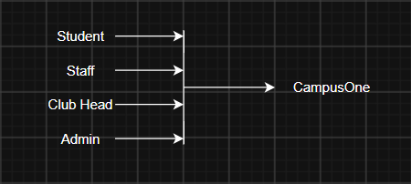
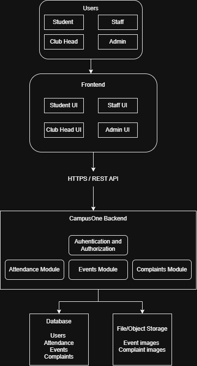
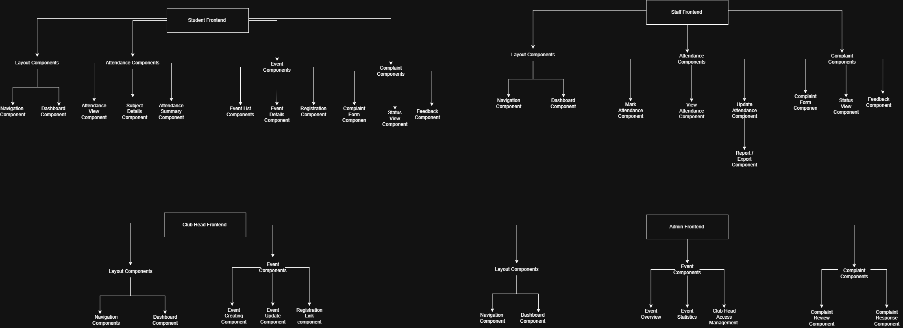
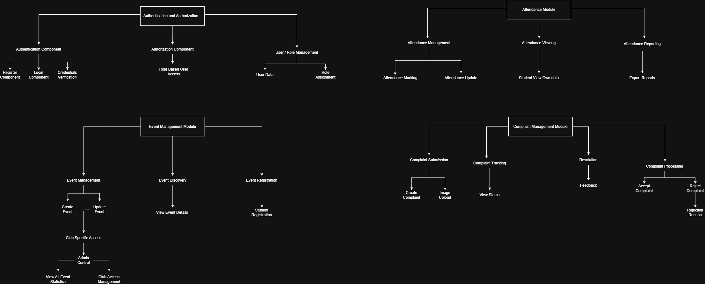

# CampusOne System Design and Requirements

**Purpose:** Consolidated design reference for the CampusOne college application
**Scope:** Attendance, event management, and complaint management
**Live demonstration:** [CampusOne](https://campusone-padk.onrender.com/login)
**Review date:** 12 October 2026

## 1. Project overview

CampusOne brings attendance, club events, and campus complaints into one role-aware web portal. Students can view their own attendance, discover and register for events, and submit concerns. Faculty manage attendance for assigned classes. Club Heads manage events for assigned clubs. Administrators configure access, supervise events, and process complaints.

The project addresses fragmented campus event information, the lack of a single subject-wise attendance view, and manual hostel complaints.

### Goals and scope

- Centralize attendance, events, and campus support.
- Enforce role and record-level authorization.
- Provide reports and audit history for important changes.

**In scope:** attendance and reports; events and registration; complaints; authentication and role-based access; audit logging; centralized backend and relational database.

**Out of scope:** fee payments, examination management, hostel room allocation, food ordering, library management, and direct college ERP integration.

**Assumptions:** users have institutional email addresses and are provisioned; faculty are associated with classes and subjects; Club Heads are assigned to clubs; internet access is available. The initial deployment serves one college. Students cannot modify attendance. Complaint images have type and size limits.

## 2. Stakeholders, users, and access

| Stakeholder / role               | Needs and responsibilities                                                                               |
| -------------------------------- | -------------------------------------------------------------------------------------------------------- |
| College management               | Oversight, operational outcomes, reports, and policy decisions                                           |
| Students                         | View own attendance and complaints; browse and register for events                                       |
| Teaching staff                   | Mark attendance for assigned classes, view reports, raise complaints                                     |
| Club Heads                       | Create and manage events for assigned clubs                                                              |
| Administrators                   | Manage academic setup and access, supervise events, review complaints, assign Supervisors, audit changes |
| Development and maintenance team | Build, deploy, secure, monitor, and support the application                                              |

| Role      | Primary permitted scope                                                                              |
| --------- | ---------------------------------------------------------------------------------------------------- |
| Student   | Own attendance and complaints; event listings and own registrations                                  |
| Staff     | Assigned attendance classes; own complaints; Supervisor work only when designated and assigned       |
| Club Head | Events for assigned clubs; Student capabilities only when also granted Student                       |
| Admin     | Administrative setup, event supervision, complaint review and assignment, reports, access management |

Authorization is enforced on the backend; hiding interface controls is not sufficient. Admin access is not available through public registration. Role grants and assignments are audited.

## 3. Requirements analysis

The current source list contains **36 functional requirements** and **11 non-functional requirements**, counted one item per statement. IDs below are assigned for traceability. Performance and capacity estimates are separate from the requirement counts.

### 3.1 Functional requirements

| ID        | Requirement                                                                         |
| --------- | ----------------------------------------------------------------------------------- |
| FR-ATT-01 | Assigned staff can mark attendance for a class, section, subject, date, and period. |
| FR-ATT-02 | Authorized staff can update a previously marked class session.                      |
| FR-ATT-03 | Staff can view attendance for classes and subjects they handle.                     |
| FR-ATT-04 | Staff can export attendance reports.                                                |
| FR-ATT-05 | Staff can identify whether attendance is already marked for a class and period.     |
| FR-ATT-06 | Students can view attendance for enrolled subjects.                                 |
| FR-ATT-07 | Students can view their attendance percentage.                                      |
| FR-ATT-08 | Students cannot access another student's attendance records.                        |
| FR-ATT-09 | Students cannot modify attendance records.                                          |
| FR-EVT-01 | Administrators can view current, upcoming, and past events.                         |
| FR-EVT-02 | Administrators can grant Club Heads event-posting access.                           |
| FR-EVT-03 | Administrators can view participation statistics.                                   |
| FR-EVT-04 | Administrators can supervise club events.                                           |
| FR-EVT-05 | Administrators can manage club and event access.                                    |
| FR-EVT-06 | Administrators can view all events.                                                 |
| FR-EVT-07 | Club Heads can create events for their assigned club.                               |
| FR-EVT-08 | Club Heads can update their club's events.                                          |
| FR-EVT-09 | Club Heads can provide event details and registration links.                        |
| FR-EVT-10 | Club Heads cannot modify another club's events.                                     |
| FR-EVT-11 | Students can view events from all clubs.                                            |
| FR-EVT-12 | Students can view event details.                                                    |
| FR-EVT-13 | Students can register for events.                                                   |
| FR-EVT-14 | Students cannot modify event information.                                           |
| FR-EVT-15 | Duplicate registration by one user for an event is prevented.                       |
| FR-CMP-01 | Administrators can view submitted complaints.                                       |
| FR-CMP-02 | Administrators can accept or reject complaints.                                     |
| FR-CMP-03 | Rejection requires a reason.                                                        |
| FR-CMP-04 | Administrators can update the status of accepted complaints.                        |
| FR-CMP-05 | Administrators can mark accepted complaints as resolved.                            |
| FR-CMP-06 | Administrators can view feedback for resolved or rejected complaints.               |
| FR-CMP-07 | Students and staff can submit complaints.                                           |
| FR-CMP-08 | A complaint can include a description.                                              |
| FR-CMP-09 | A complaint can include an optional image.                                          |
| FR-CMP-10 | Users can view the status of their own complaints.                                  |
| FR-CMP-11 | Users can view the response or reason when a complaint is rejected.                 |
| FR-CMP-12 | Users can provide feedback after resolution or rejection.                           |

### 3.2 Non-functional requirements

| ID     | Requirement                                                                       |
| ------ | --------------------------------------------------------------------------------- |
| NFR-01 | Attendance displays are separated for students and staff.                         |
| NFR-02 | Attendance views normally respond within 500 ms under normal load.                |
| NFR-03 | Attendance marking normally completes within 2 seconds.                           |
| NFR-04 | Event listings normally load within 500 ms under normal load.                     |
| NFR-05 | Event registration normally completes within 2 seconds.                           |
| NFR-06 | Events are visually separated by club.                                            |
| NFR-07 | An administrator should accept or reject a complaint within 2 hours.              |
| NFR-08 | A complaint should be resolved within 2 days, depending on severity.              |
| NFR-09 | Rejected complaints include a detailed reason.                                    |
| NFR-10 | Complaint submission normally completes within 2 seconds, excluding image upload. |
| NFR-11 | Complaint status normally loads within 500 ms.                                    |

These are design targets, not evidence of production load testing or service-level guarantees.

### 3.3 Scale and workload targets

| Measure                                |                     Source target |
| -------------------------------------- | --------------------------------: |
| Students / staff / Club Heads / Admins |          ~2,000 / ~100 / ~20 / ~5 |
| Registered-user capacity               |                       Up to 2,500 |
| Normal concurrent users                |                       ~500–1,000 |
| Peak concurrent users                  |                              ~300 |
| Peak requests                          |                At least 60/minute |
| Attendance requests                    |        30–60/minute during peaks |
| Event requests                         | 20–50/minute during normal peaks |

**Open decision:** the stated normal concurrency (500–1,000) is greater than the stated peak concurrency (300). Confirm whether the normal figure means active or registered users, or revise one of the values.

## 4. Technology stack and justification

The current selected architecture is one Dockerized Express modular monolith serving a React/Vite frontend and REST API from one HTTPS origin, with Neon PostgreSQL. GitHub Actions validates changes; Render deploys the main branch after CI checks pass.

The alternatives below are comparison candidates; they are not recorded as previously approved decisions.

| Area           | Selected                                           | Alternatives                                        | Rationale                                                                                                                                                                                                |
| -------------- | -------------------------------------------------- | --------------------------------------------------- | -------------------------------------------------------------------------------------------------------------------------------------------------------------------------------------------------------- |
| Frontend       | React + Vite                                       | Vue + Vite; Angular                                 | Matches the implemented component UI and build setup.                                                                                                                                                    |
| Backend        | Node.js 24 + Express modular monolith              | NestJS monolith; separate services                  | One deployable service fits the current scope while preserving module boundaries and shared authentication.                                                                                              |
| ORM            | Prisma 7                                           | Drizzle; SQL query builder                          | Already used for schema, migrations, and PostgreSQL access.                                                                                                                                              |
| Database       | Neon PostgreSQL                                    | Another managed PostgreSQL; self-managed PostgreSQL | Relational constraints and transactions fit attendance, registration, complaint routing, and audit data; Neon separates persistent data from app lifecycle.                                              |
| Hosting        | Render Docker Web Service                          | Railway; AWS ECS + managed PostgreSQL               | Reuses the current image and provides one same-origin deployment. ECS offers more control with more operational work. Railway appears in historical phase notes; Render + Neon is the current selection. |
| CI/CD          | GitHub Actions checks + Render deploy gate         | GitHub Actions deployment job; another CI provider  | Avoids duplicate production deployment jobs and deployment credentials.                                                                                                                                  |
| Image storage  | PostgreSQL bytea; 2 MiB/image, 50 MiB shared quota | S3-compatible object storage                        | Fits current demonstration scope and keeps access control in the app; revisit as volume grows.                                                                                                           |
| Authentication | Domain-only demonstration mode                     | College SSO; verified institutional email           | Suitable only for controlled demo. A matching domain does not prove identity or mailbox ownership.                                                                                                       |

## 5. High-level design

### 5.1 System context

Students, faculty, Club Heads, and administrators use the portal. The application serves frontend and API from one HTTPS origin, with PostgreSQL for application records and image bytes. Direct ERP integration is out of scope.

### 5.2 Application architecture

The backend is a modular monolith. Authentication and authorization are shared across Attendance, Events, and Complaints. PostgreSQL stores user, academic, attendance, event, registration, complaint, assignment, and audit data. Render hosts the Dockerized service, Neon hosts PostgreSQL, and GitHub Actions runs CI checks. The deployment guide's owner steps and environment configuration remain distinct from historical local verification.

## 6. Low-level design

### 6.1 Frontend

The portal uses role-aware pages for Students, Staff, Club Heads, and Admins, with shared navigation and module-specific views.

### 6.2 Backend

Authentication/registration, Attendance, Events, and Complaints each use validated routes and service logic. Authorization is checked before data access. Critical writes use database constraints and transactions.

Editable Draw.io component diagrams are in [docs/.drawio](.drawio/) for the overall system, authentication, Attendance, Events, Complaints, and Student, Staff, Club Head, and Admin interfaces. The Admin interface source exists without a matching exported PNG.

## 7. Module workflows

### Attendance

1. Admin configures terms, classes, sections, subjects, offerings, and teaching assignments.
2. Admin or assigned Staff preview and maintain the official roster.
3. Faculty select class, subject, date, and period; the portal loads the roster or saved session.
4. Faculty enter present or absent register numbers, review the calculated roster, and confirm.
5. Empty or unknown input, duplicate sessions, and stale versions block unsafe saves.
6. The complete session is saved transactionally. A correction requires assigned Staff and a reason; changed statuses are audited.
7. Students see only their own attendance. Staff and Admin reports follow their authorization scope.

### Events

1. Admin assigns a Club Head to a club.
2. The Club Head creates a draft event for that club.
3. Publishing requires description, venue, a future start, and an open registration deadline; an optional end must follow the start.
4. Students browse, filter, view details, and register under their authenticated identity.
5. Duplicate registrations are prevented. Registration closes at its deadline or event start.
6. Club Heads can edit only assigned-club events. Admin supervises events; cancellation preserves visible history and registrations.
7. Times are stored as UTC instants and displayed in Asia/Kolkata (IST).

### Complaints

1. Student or approved Staff submits title, description, category, campus location, and optional image. Students may select a provisional group.
2. Submitters can see only their own complaint and its public status.
3. Admin accepts or rejects; rejection requires a public reason.
4. Acceptance requires routing and an eligible designated Supervisor. Unassigned cases remain visibly awaiting assignment.
5. Supervisor records private progress and any external Block Warden handoff.
6. Supervisor resolves with public details. Warden coordination happens outside CampusOne.
7. Original submitter can provide feedback once after resolution or rejection.
8. Internal notes and reassignment reasons are not visible to submitters.

## 8. Data integrity and audit

Core data includes users and roles; academic terms, classes, offerings, assignments, rosters, sessions, and attendance; clubs, events, registrations, and image metadata; complaints, assignments, internal notes, feedback, and audit records.

Integrity rules include one status per student per session; no duplicate attendance session; own-record student access; assigned-club event changes; one registration per user/event; reason-required rejection; resolution only after acceptance; and feedback only after closure. Important corrections, access changes, event edits, and complaint routing/status changes record actor and timestamp.

Complaint images are private to the submitter, Admin, and currently authorized assigned Supervisor. Current limits are one JPEG/PNG per record, 2 MiB per image, and a shared 50 MiB quota.

## 9. Live implementation review

The deployment was opened on 12 October 2026 using the supplied demonstration accounts. The review was read-only; no attendance, registration, event, or complaint records were created or changed.

- Student home loaded. Attendance showed register number 995601001, 1 of 2 sessions, and 50.00% for DEMO101.
- Student events showed two upcoming events. An event detail displayed date/time, venue, deadline, and the student's existing registration.
- Club Head event management loaded four events, with statuses and registration counts.
- Student complaint submission form loaded; the complaint list remained loading during review.
- The supplied Staff account had no department assignment; its attendance page remained at “Loading assigned classes.” It did not demonstrate faculty marking.
- No Admin account was supplied, so Admin behavior was reviewed from design/phase docs rather than a live Admin session.

### 9.1 Dashboard screenshots

These captures show the deployed demo interface and synthetic demonstration records.

#### Sign in / Create Account

#### Student

#### Staff

#### Club Head

Routes require sign-in for dashboard content. No demo credentials are included in this document.

## 10. Open decisions and limitations

1. Resolve the concurrency mismatch between normal (500–1,000) and peak (300).
2. Confirm requirement wording and totals with stakeholders.
3. Approve or revise the comparison alternatives; only the selected stack is a recorded project decision.
4. Choose college-approved identity verification or SSO before genuine institutional use.
5. Confirm complaint escalation, retention, privacy, and access policy.
6. Confirm event registration rules and attendance correction deadlines.
7. The Render/Neon guide contains owner steps and placeholders. A reachable demo page does not validate backups, recovery, access controls, or performance targets.
8. Add saved dashboard PNGs and an exported Admin interface component diagram.

## 11. Source documents

- [Initial project and requirements brief](CampusOne.md)
- [Current deployment architecture](architecture.md)
- [Attendance implementation and verification](phase2-attendance.md)
- [Event implementation and verification](phase3-events.md)
- [Complaint implementation and verification](phase4-complaints.md)
- [Integration and deployment record](phase5-integration-deployment.md)
- [Render and Neon operator guide](render-neon-deployment.md)
